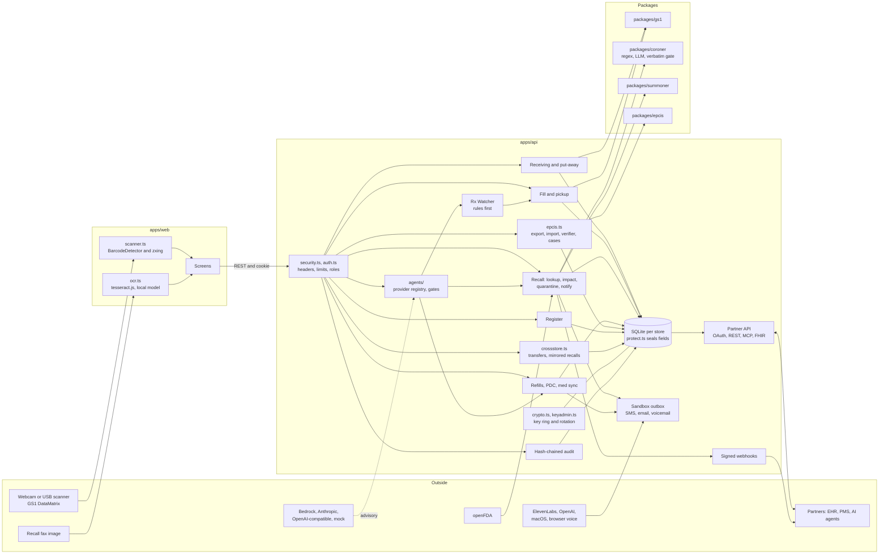

# Architecture

One Fastify API (`apps/api`) owns the lot ledger in SQLite, one database file per store. The React app (`apps/web`) talks to it over a session-cookie REST API. Partners and AI agents use a separate surface (`/oauth/token`, `/v1`, `/mcp`, `/fhir/r4`) with their own credentials and scopes. Four shared packages hold the pure logic: GS1 rules, the openFDA client, the lot extractor and EPCIS.

## How a recall flows

1. **Notice.** A pharmacist types the FDA recall number, or the browser OCRs the fax image. Night Watch polls openFDA every 2 hours and opens a recall only if its lots match lots this store holds; it never confirms a lot.
2. **Extract.** The Coroner pulls NDC, lots and expiry from the notice. Regex runs first. A model may add candidates, but a lot that is not found as a whole token in the source text is dropped.
3. **Confirm.** Lots with confidence of 0.95 or more and an expiry are confirmed for the pharmacist who looked them up. Anything else waits for a per-lot confirmation.
4. **Quarantine.** Every on-shelf package of a confirmed lot moves to Quarantine Q-1. Fills scanned but not yet picked up go back to the bench. The lot is blocked at receiving, fill, the register, transfers and refills, and the recall is mirrored to the other store.
5. **Impact.** Patients come from the sold dispenses of those lots, which is why lot is captured at fill. Each patient's channels are computed from consent at that moment.
6. **Notify.** The pharmacist edits the templates (or presses **Use AI draft**), ticks the attestation and sends. Messages go to the sandbox outbox. The outreach job places simulated voicemail calls within calling hours.
7. **Trace and close.** The recall trace can be exported as EPCIS (patient ids only). Return pickup, manufacturer response and a PDF audit report close it out.

## How an agent runs

`apps/api/src/agents/` holds the runtime. Each agent has a deterministic core, an optional model call through the provider registry (`providers.ts`: Bedrock, Anthropic, OpenAI-compatible, mock, none) and a gate that drops anything the rules or the source do not back up. `LlmCall.ask` refuses to send a prompt that matches a patient name, phone, email or date of birth. Every run is stored in `ai_runs` (encrypted) with provider, model, latency, prompt, raw and gated output and the dropped list. See [AGENTS.md](AGENTS.md).

## Data

SQLite through built-in `node:sqlite`. One file per store: `data/chimera-rx.sqlite` and `data/chimera-rx-store-2.sqlite` (`TWO_STORES=0` makes only the first). `apps/api/src/db.ts` is the only data-access path and seals the columns listed in `apps/api/src/protect.ts` ([SECURITY.md](SECURITY.md)). Main tables:

| Area | Tables |
| --- | --- |
| Staff | `stores`, `users`, `sessions`, `mfa_codes` |
| Ledger | `products`, `lots`, `packages`, `lot_events`, `deliveries`, `delivery_lines`, `ti_records`, `problems` |
| Dispensing | `patients`, `prescriptions`, `dispenses`, `med_history`, `rx_findings`, `prescriber_messages`, `stock_decisions` |
| Front store | `otc_items`, `sales`, `sale_lines` |
| Recalls | `recalls`, `recall_lots`, `recall_actions`, `fax_inbox`, `notifications`, `outbox`, `outreach_calls`, `audio` |
| DSCSA | `verification_requests`, `suspect_cases`, `trace_imports` |
| AI | `ai_runs`, `ai_drafts` (older `agent_runs` and `events` also exist) |
| Partners | `integrations`, `oauth_tokens`, `api_log`, `webhooks`, `webhook_deliveries`, `webhook_inbox` |
| Audit | `audit` (each row carries the hash of the previous one) |

A package is the unit of truth: one row per serial, with a status (`pending_putaway`, `on_shelf`, `quarantined`, `dispensed`, `returned`, `adjusted`). The property test in `apps/api/test/store-flow.test.ts` checks that on hand always equals received minus dispensed, returned and adjusted, and that no serial is dispensed twice.

## Two stores

Each store has its own database, staff, patients and stock, and each request is routed to one store by the session. Only two things cross: **transfers** (a package keeps its lot and serial, both stores log it) and **mirrored recalls** (a recall confirmed in one store quarantines the lot in the other; the other store's pharmacist still attests before any message). Code: `stores.ts`, `crossstore.ts`; tests: `apps/api/test/two-stores.test.ts`.

## Background jobs (`apps/api/src/server.ts`)

| Schedule | Job |
| --- | --- |
| every minute | Rx Watcher reviews new prescriptions |
| every 5 minutes | outreach job places due voicemail calls (simulated) |
| every 2 hours (UTC), and at start-up | Night Watch polls openFDA (off with `NIGHT_WATCH=0`) |
| daily 06:00 UTC, and at start-up | Night Watch agent digest |

## Staff API (session cookie, role-checked)

| Area | Routes |
| --- | --- |
| Auth | `GET /api/auth/config`, `POST /api/auth/login`, `/sso`, `/logout`, `GET /api/me`, `GET /api/stores` |
| Today | `GET /api/today`, `GET /api/search` |
| Receiving | `GET /api/deliveries[/:id]`, `POST /api/deliveries/:id/scan`, `POST /api/packages/:id/putaway`, `/problem` |
| Inventory | `GET /api/lots[/:id]`, `POST /api/lots/:id/move`, `/adjust` |
| Fill | `GET /api/rx[/:rx]`, `/review`, `/change-draft`, `POST /api/rx/:rx/scan`, `/decision`, `POST /api/dispenses/:id/label`, `/verify`, `/sendback`, `/sell` |
| Prescriber | `GET /api/prescriber-messages`, `POST /api/prescriber-messages/:id/respond` |
| Patients | `GET /api/patients[/:id]`, `POST /api/patients/:id/refill-sync` |
| Refills | `GET /api/refills`, `GET /api/refills/drafts`, `POST /api/refills/draft`, `/send` |
| Recalls | `GET /api/recalls[/:id]`, `GET /api/fax`, `POST /api/recalls/lookup`, `/confirm-lot`, `/messages`, `/preview`, `/notifications`, `/results`, `/voicemail`, `/calls`, `/return-pickup`, `/manufacturer-response`, `/close`, `GET /api/recalls/:id/report.pdf`, `GET /api/recalls/:id/trace-export` |
| DSCSA | `GET /api/epcis/export`, `POST /api/epcis/import`, `GET /api/epcis/imports`, `POST /api/dscsa/verify`, `GET /api/dscsa/verifications`, `GET/POST /api/dscsa/cases`, `POST /api/dscsa/cases/:id/quarantine`, `/close` |
| Register | `GET /api/register/items`, `/patients[/:id]`, `POST /api/register/sales` |
| Stock help | `GET /api/stock-help`, `POST /api/stock-help/decision` |
| Transfers | `POST /api/transfers` |
| Agents | `GET /api/agents`, `GET/POST /api/agents/provider`, `POST /api/agents/provider/test`, `GET /api/agents/runs`, `/drafts`, `GET /api/agents/:id`, `POST /api/agents/:id/run` |
| Outreach | `POST /api/outreach/run`, `POST /api/calls/inbound`, `POST /api/sms/inbound` (STOP), `GET /api/outbox`, `GET /api/audio/:id`, `GET /api/voice` |
| Audit | `GET /api/audit`, `/verify`, `/export` |
| Integrations | `GET/POST /api/integrations`, `POST /api/integrations/:id`, `/rotate`, `/webhooks` |
| Other | `POST /api/night-watch/run`, `POST /api/ocr/parse` |

The role of each route is checked on the server. `apps/api/test/review-matrix.test.ts` calls every route as every role. There are no demo routes: reseeding and scenario fixtures live in `apps/api/test/scenario-fixtures.ts` and the e2e harness (`scripts/e2e/harness.ts`), never in the product API.

## Partner API (OAuth 2.0 client credentials, per-partner scopes)

| Surface | Routes |
| --- | --- |
| Token | `POST /oauth/token` (1-hour bearer tokens) |
| REST | `GET /v1/availability`, `/v1/inventory`, `/v1/recalls/:fda/status`, `/v1/recalled-lots`, `/v1/change-requests`, `POST /v1/change-requests/:id/response`, `GET /v1/patients/:id/medications` |
| MCP | `POST /mcp` (stateless JSON-RPC; an agent only sees the tools its scopes allow). Tools include `lot_trace` (scope `inventory.read`) and the read-only `agent_night_watch_digest`, `agent_stock_advisor`, `agent_copilot` (scope `agents.read`) |
| FHIR R4 | `GET /fhir/r4/metadata`, `Medication`, `MedicationDispense`, `Patient/:id` |

Patient data needs the `patient.read` scope, a BAA flag on the partner record and an admin's approval. Every partner call is written to `api_log`.

## Outside connections (placeholders, not wired)

Every outbound connection a real deployment would need is listed in [INTEGRATION_PLACEHOLDERS.md](INTEGRATION_PLACEHOLDERS.md), with its purpose, trigger, allowed data, consent, `PLACEHOLDER_...` env names and today's sandbox stand-in. The seam is `apps/api/src/channels.ts` (`NotConfiguredChannel` throws "not configured in this demo"); nothing constructs it, and no provider code or SDK exists.

## Serving and deployment

In production the API serves the built web app from `apps/web/dist`, looked up on disk per request, so a rebuild needs no restart. The Dockerfile builds the web app and runs the API on port 4000. `docker-compose.yml` adds a volume for `/app/data`, a health check on `/api/health` and the `DATASET`, `MFA`, `TWO_STORES` and `SEED_SYNTHETIC` switches (`SEED_SYNTHETIC=1`, the default, seeds the synthetic dataset on a fresh database). In development, Vite on 5173 proxies `/api`, `/v1`, `/mcp`, `/fhir`, `/oauth` and `/hooks` to the API. If the web app runs on another origin, add it to `CORS_ORIGINS`.

## Known limits

- One SQLite file per store. No multi-tenant isolation or row-level security.
- There is no SSO. MFA is built and tested but off by default; its codes go to the sandbox outbox.
- No TLS in the app; the key sits on the same host as the data by default. See [SECURITY.md](SECURITY.md).
- The model paths were exercised with test doubles and a deterministic mock, plus one live Bedrock check (2026-11-20).
- The camera path was rehearsed with a fake camera, not a physical webcam.
- The Docker image build was not run on the machine that wrote this repo.
