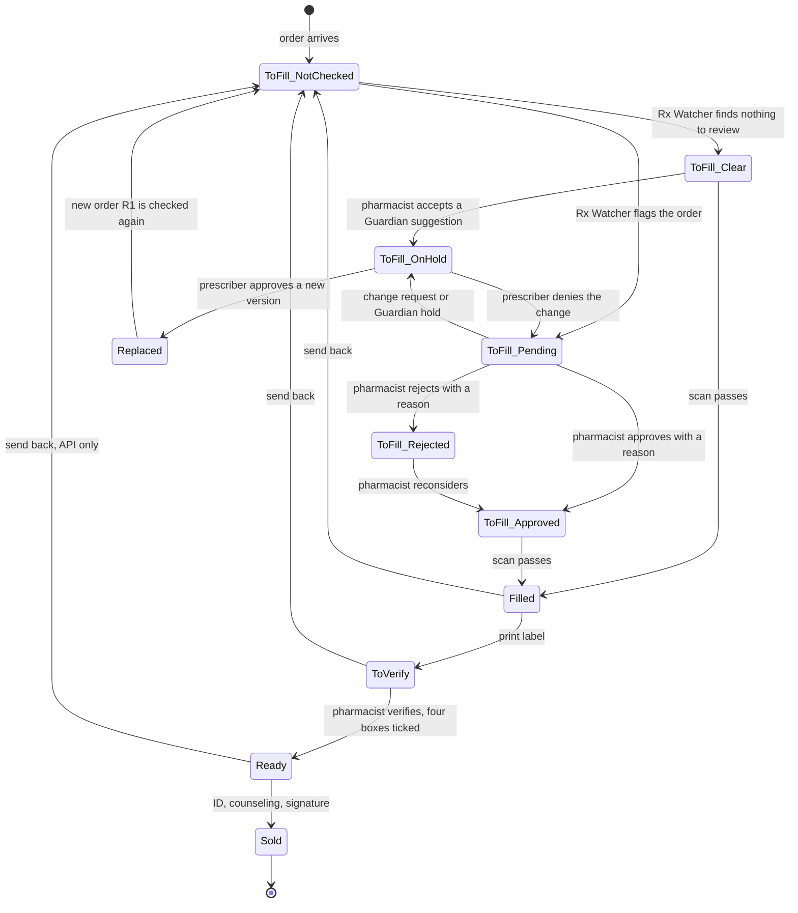

# Fill & pickup: every path

This page maps every path an order can take on the **Fill & pickup** screen, how to trigger each one in the demo, and the safety rule each path enforces. All data is synthetic. Everything here is a sandbox: no prescriber, payer or patient is contacted, and nothing here is a clinical or compliance claim.

Routes below are web routes (the app uses hash routes, so `#/fill?rx=0072214` opens that order) and the API calls behind them. Every path in section 3 was run against a live API with demo data (`LG_DEMO=1`, `LLM_PROVIDER=mock`), and the main path and the no-serial path were also clicked through in a browser. What was not run is listed in section 5.

## 1. The state machine

An order has a **status** (where it is in the fill) and, while it is still "to fill", a **review** (what Rx Watcher and the pharmacist decided). The two are shown together in the queue chip.

Status names in the UI are To fill, Filled, To verify, Ready and Sold. A review chip shows To review, On hold or Rejected while the status is To fill. Code: `apps/api/src/fill.ts`, `rxwatcher.ts`, `prescriber.ts`, `agents/guardian.ts`.

The five-step bar on the order is Review, Scan, Label, Verify, Pickup.

## 2. Who can do what

| Action | Pharmacist | Technician | Cashier |
| --- | --- | --- | --- |
| Open the queue and an order | yes, full profile | yes, full profile | yes, but no date of birth, no email, no allergies, no Rx Watcher or Guardian panels |
| Run Rx Watcher | yes | yes | no |
| Approve, reject, ask the prescriber to change | yes | no (reads findings) | no |
| Accept, dismiss or escalate a Guardian suggestion | yes | no (reads evidence) | no (403) |
| Scan the package | yes | yes | no |
| Print label | yes | yes | no |
| Verify | yes | no | no |
| Send back | yes | no | no |
| Complete the sale at pickup | yes | no | yes |

All of these are checked on the server. The web screen only hides what the server would refuse.

## 3. Paths, how to trigger them, and the rule each enforces

The demo orders exist after **Reset demo** (Demo guide). Scan codes come from **Test labels** or the printed fill labels.

| # | Path | How to trigger it in the demo | What happens | Rule enforced |
| --- | --- | --- | --- | --- |
| 1 | **Clean order, full run** | Reset. Open Rx 0072214 (Linda Chen, atorvastatin). Rx Watcher shows Clear. On Scan, paste the Test labels code for atorvastatin lot AT24K118 serial 24118006. | Status goes To fill, Filled (checks: NDC matches, recall clear, expiry), To verify (**Print label & send to pharmacist**), Ready (pharmacist ticks four boxes, **Approve as**), Sold (ID, counseling, signature, **Complete sale**). The sold card shows lot, serial and expiry and says she will be on a recall list automatically. | Lot and serial are saved on the prescription. A pharmacist verifies (rule 3). |
| 2 | **Flagged by Rx Watcher** | Open Rx 0072210 (Daniel Brooks, insulin glargine). The queue chip says "Rx Watcher · 2 flags". | Findings: unusual frequency (twice a day for a once-daily insulin) and days supply that does not match the quantity. A scan before a decision is refused: "Rx Watcher flagged this order. A pharmacist must review it first." (HTTP 409, `needs_review`). | Rule 6 (rules before the model) and plan goal G5: no scan until a pharmacist decides. |
| 2a | Approve as written | On 0072210, **Approve as written…**, type a reason of at least 5 characters, **Approve as**. | Review becomes Approved. Without a reason the server answers 422 `reason_required`. A technician gets 403. A finding of severity "block" (an allergy conflict) cannot be approved at all (409 `blocked`). | Rule 3 (a pharmacist decides). |
| 2b | Reject | **Reject…** with a reason of at least 5 characters. | Review becomes Rejected, a scan is refused ("This order was rejected."). A pharmacist can still approve it later if they reconsider. | Rule 3. |
| 2c | Ask the prescriber to change | **Ask prescriber to change** opens a drafted message and a proposed fix (once-daily at bedtime, 68 days supply). Edit, then **Send change request**. | The order goes On hold. A sandbox RxChangeRequest (NCPDP SCRIPT-shaped, id `SCRIPT-…`) appears in the order's message thread. A scan is refused: "on hold waiting for the prescriber." | Nothing leaves the machine (rule 2). |
| 2d | Prescriber approves | In the thread, **Prescriber approved** (sandbox: the pharmacist records the reply). | A new version `0072210-R1` is created with the corrected directions and is checked by Rx Watcher again (it came back Clear). The original is marked Replaced, kept unchanged, and the screen shows **Open Rx 0072210-R1**. A scan against the old number is refused with "replaced by a new version". | Versions are immutable. The change is checked again. |
| 2e | Prescriber denies | **Prescriber denied**. | The original returns to "To review" with the note "Prescriber denied the change", the same flags, and the pharmacist decides again (path 2a or 2b). | Rule 3. |
| 3 | **Rx Guardian suggestion** | Reset. The seed switches Rx Guardian on; within about a minute (or **Run now** on AI agents) Rx 0072210 shows "Rx Guardian · 5 suggestions" and a panel "Rx Guardian found 5 things in this patient's history". | Each suggestion shows severity, an explanation, and evidence from the history (fills, lots, adherence). Examples from the run: gaps in insulin fills (42 percent of days covered over 180 days), a lisinopril and insulin note, a late atorvastatin refill. Everything is labelled "AI advisory, a pharmacist decides". | Rule 6. The agent never changes an order. |
| 3a | Accept: hold the order | **Accept: hold the order**, optional note, **Put order on hold**. | The order goes On hold with the reason ("Rx Guardian: <title>. <note>"). A scan is refused. The button is disabled if the order is already being filled. | Rule 3. |
| 3b | Dismiss | **Dismiss…** with a reason of at least 5 characters. | The suggestion closes as dismissed, with the reason and the pharmacist's name. | Reason is required and audited. |
| 3c | Prescriber request | **Send prescriber change request** on a suggestion. | The same sandbox RxChangeRequest as path 2c, with the history facts as the reason. The order goes On hold. Then 2d or 2e. | Same as 2c. |
| 3d | Technician or cashier view | Sign in as the technician: suggestions are readable, the buttons are not there ("A pharmacist decides."). The cashier gets no panel and the API answers 403. | | Roles on the server. |
| 4 | **Wrong drug** | On 0072214, paste the insulin label code. | Refused: "Wrong drug. This package is 70004-623-15 … the prescription needs 70004-803-90." (409 `wrong_ndc`). Nothing is recorded. | NDC must match the prescription. |
| 5 | **Scan with a serial** | Paste a code with `(21)`: atorvastatin AT24K118 serial 24118006. | The exact package is matched in the ledger. Its serial is recorded as read. | Rule 7: the serial shown was scanned. |
| 5a | **Scan without a serial (inferred)** | Paste a code without `(21)`, for example `(01)…(17)271231(10)AT24K118`. The insulin order needs approval first (path 2a). | The oldest on-shelf unit of that lot is assumed (insulin: serial 0000906 instead of 0000907). The response says `inferredSerial: true` and the screen shows an amber note: "No serial was scanned, so the oldest unit of this lot on the shelf was assumed. It was not read from the package." The pharmacist can **Send back** and rescan with the real serial (verified: the rescan picked 0000907). | Rule 7: inferred is not read. Known gap: the flag is returned only in the scan response, so the amber note disappears if the page is reloaded, and the ledger does not store it. |
| 5b | Serial never received | Scan a code with a serial that Receiving never recorded. | Refused: "Serial … was never received here. Check it in at Receiving first." (`not_in_ledger`). | The ledger, not the label, is the truth. |
| 5c | Label without a barcode (OCR) | **Read label text (OCR)** or **Upload a label photo**, check the four fields, **Use these values**. | The same checks as a scan, source "ocr". The OCR text is a suggestion the person edits first. | OCR results are suggestions (rule 7). |
| 6 | **Recalled lot blocked at fill** | Reset, then Demo guide, scenario "Class I recall". On 0072210 approve (path 2a). On Recalls, look up `D-0611-2026` (pharmacist only). Then scan lot GX4471C. | Refused: "Recalled lot. GX4471C is in recall D-0611-2026. Do not dispense." (409 `recalled`), with or without a serial. After **Close recall** the same scan is still refused. The order screen's "Pick from" hint skips recalled lots. | Rule 8: recalled stays blocked, even after the recall is closed. |
| 7 | **Already filled** | Scan again on an order that is already Filled, To verify or Sold. | Refused: "This prescription already has a package scanned." (409 `already_scanned`). The check is repeated inside the database transaction, so a double submit cannot dispense two packages. | One package per order. |
| 8 | **Send back** | At Filled or To verify, the pharmacist presses **Send back**, types a reason of at least 3 characters, presses **Send back**. Seed order 0072219 (James Okafor, amoxicillin) is already at To verify. | The dispense is marked sent back, the package returns to the shelf, the order returns to To fill, a "Released" lot event is written, and the reason is audited. A technician gets 403. A sold fill cannot be sent back (409). From Ready (for example 0072187) the API accepts it too, but the screen has no button there. | Rule 3. Stock stays honest. |
| 9 | **Verify** | At To verify, only a pharmacist sees the checklist: patient and prescription match, dose in range, no interactions on profile, package matches NDC, lot and serial. All four ticks needed. | Partial ticks: 422 "Tick every item…". A technician sees "Waiting for a pharmacist to verify." and the API answers 403. | Rule 3. |
| 10 | **Pickup, ID check, hand-over** | At Ready: "Pickup at register 2" with Photo ID verified, Counseling offered, Signature captured. **Complete sale** is enabled only when all three are ticked. Technician sees "A cashier or pharmacist completes the sale." | Missing a box: 422 `pickup_checklist`. Selling before verification: 409. After the sale: the card with lot, serial, contact channel on file, and **Next prescription**. The sale writes the record that a later recall joins on. | The recall-to-patient link exists only because the lot was recorded at fill. |
| 11 | **Cashier pickup-only view** | Sign in as `m.diaz@elmstreetrx.example`. Open Grace Miller's order 0072187. | The cashier sees name, drug, directions and the pickup panel. Date of birth, email and allergies come back empty, and there is no Rx Watcher or Guardian panel and no scan panel. On the **Register** screen the cashier completes the same pickup checks for a patient's verified prescriptions. | Cashier never sees allergies or date of birth. |
| 12 | **Return to stock** | This is the Send back path (8). There is no separate "return to stock" screen. | See path 8. | |
| 13 | **Refill route** | Refills screen, not Fill & pickup. | The worklist, adherence and sync are rule-based. **Draft reminders** makes drafts a pharmacist approves and sends to the sandbox outbox. A patient whose last fill came from a recalled lot, or a Schedule II drug, gets no reminder. A refill does **not** create an order in the Fill & pickup queue in this build: the queue holds orders that already exist. | Recall hold on refills; see `docs/REFILLS.md`. |
| 14 | **Schedule II** | There is no Schedule II order in the fill queue in the seed. | Schedule II handling in this build is at **Receiving** (put-away needs a second staff member to sign in as witness, and a pharmacist for count changes and moves) and **Inventory** (Adjust count needs a witness). The fill screen has no witness step. Refills never offer a Schedule II drug automatically. | Not a fill-time control. State this plainly when asked. |

## 4. Checks that run inside a scan (in order)

1. A pharmacist decision exists (clear or approved), or the scan is refused.
2. The package is the right drug (NDC matches the prescription).
3. The lot is not in an active or closed recall.
4. The package is not expired.
5. With a serial: the serial must be in the ledger. Without: the oldest on-shelf unit of the lot is picked and flagged as inferred.
6. The package must be on the shelf (not dispensed, not in quarantine, not pending put-away).
7. In one transaction: the order moves To fill to Filled and the package moves on shelf to dispensed. If either update finds the row already changed, the scan fails.

Every step writes an audit event (`fill.scan`, `fill.label`, `fill.verify`, `fill.sendback`, `fill.sell`, `rx.approve`, `rx.reject`, `rx.change_request`, `rx.change_response`).

## 5. What was and was not run

Run against a live API, with the HTTP result recorded: paths 1, 2, 2a to 2e, 3, 3a to 3d, 4, 5, 5a, 5b, 6, 7, 8 (from Filled, from To verify and from Ready), 9, 10, 11. Clicked in a browser as the pharmacist: path 1 and 5a, including Send back and the rescan.

Not run live, read from code only: the expired-lot refusal ("Expired … Do not dispense."), the "serial is in quarantine / already dispensed" refusals (a recalled lot is refused earlier, by rule 8), the OCR scan path in the browser, and the scenario "Agent catches it" (Rx 0072301). The code is in `apps/api/src/fill.ts`.
