# Chimera Rx review for Pritesh

Reviewed **November 22, 2026**, against upstream **30408a6**. All findings remain open. This is a review and evidence package; it contains no product fixes.

Start with the five P1 groups before expanding the pilot: preserving pharmacist holds, cross-store recall propagation, clinical read authorization, medication-history continuity, and transfer recovery.

[Download the complete ZIP](Chimera-Rx-Pritesh-Findings-2026-11-22.zip) · [Structured backlog](for-pritesh/implementation-backlog.csv) · [Acceptance tests](for-pritesh/independent-review-2026-11-22.test.ts)

The ZIP contains the formatted HTML report and screenshot gallery for offline viewing. The Markdown below renders directly on GitHub. All patient data shown is synthetic. No databases, encryption keys, credentials, or dependencies are included.

## Verification

| Check | Result | Interpretation |
|---|---|---|
| Original upstream suite | 359 passed / 5 failed / 364 total | Three POSIX permission assertions on Windows; two fixture paths built with URL.pathname. |
| Expanded focused run | 189 passed / 14 failed / 203 total | 182 existing checks passed. New acceptance suite: 7 passed, 14 failed across F01-F05. Failures are intended red acceptance cases, not fixes. |
| Key recovery and rotation | 2 passed; 1 unrelated test filtered out | Wrong/lost-key fail-closed and rotation/reopen audit verification. This is not a full backup restoration drill. |
| Browser rehearsal | 48 passed / 1 failed; MFA portion skipped | Failed immediate inline-evidence check; captured screenshot contains the evidence. Likely synchronization issue, not a confirmed missing UI feature. |
| Typecheck and web build | Passed before adding review tests | Fresh locked dependency install. Local pnpm 11.25.0; repository specifies 12.16.1. |
| Docker | Full image/run not verified | Docker daemon unavailable. Manifest-only dependency stage reproduced successfully with offline install; that is not a container validation. |

The expanded run included **182 existing checks, all passing**, plus **21 new acceptance checks: 7 passing and 14 failing**. These failures reproduce F01–F05; they are not 14 independent defects. The review test file is stored under docs and is not discovered by the normal test command.

## Findings

### F01 P1 — Automatic review overwrites a pharmacist hold

**Evidence:** Deterministic concurrency reproduction.
**Source:** [apps/api/src/rxwatcher.ts:233](https://github.com/pjborad/Chimera-Rx/blob/30408a6/apps/api/src/rxwatcher.ts#L233). Also apps/api/src/fill.ts:99.

**Reproduce:** Start scanFill for Rx 0072214 with review=none and pause the model response. While paused, submit a valid pharmacist change request; confirm review=on_hold. Release the model. The review becomes clear and the scan fills the order.

**Impact:** A pharmacist decision made during an automatic review is lost, and an order awaiting a prescriber change can proceed to filling.

**Suggested implementation:** Persist automatic findings using a conditional update against the current order version and review state. Revalidate review and version inside the fill transaction. Do not rely on the review value read before an await.

**Acceptance checks:** The hold and change-request record survive model completion; the scan returns a conflict and creates no dispense. Repeat with reject, approve, order edits and simultaneous review runs.

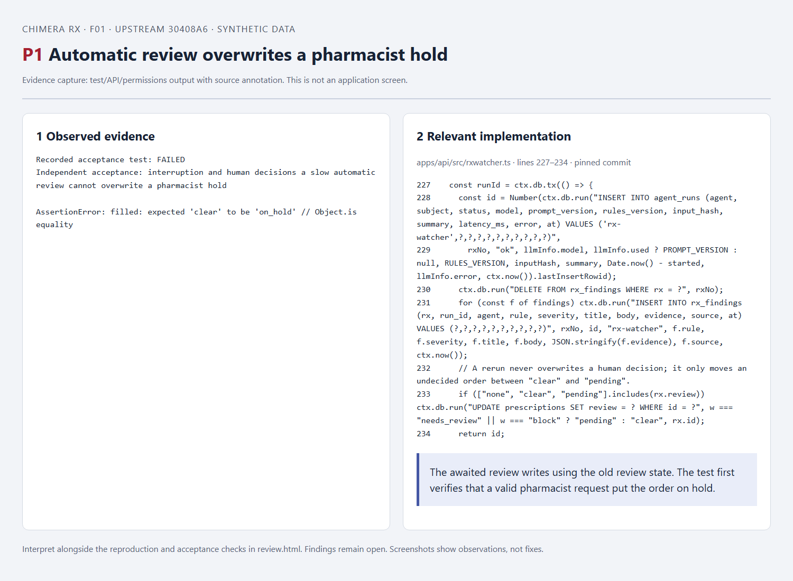

*Annotated evidence capture: The awaited review writes using the old review state. The test first verifies that a valid pharmacist request put the order on hold.*

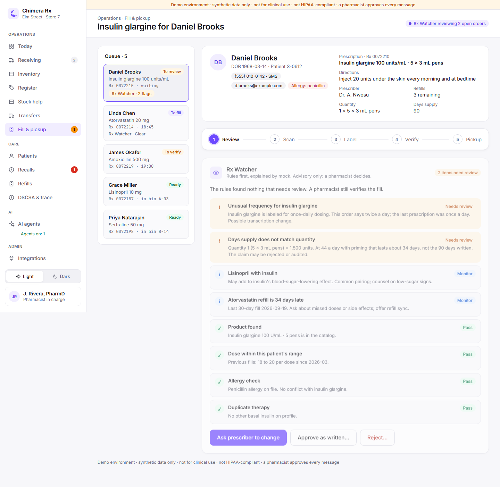

*Actual application screenshot: Prescription review workflow. Earlier synthetic browser rehearsal; workflow context only, not a capture of the backend failure.*

### F02 P1 — Pending destination recall prevents confirmation from propagating

**Evidence:** Two-store acceptance reproduction and successful fresh-destination control.
**Source:** [apps/api/src/crossstore.ts:84](https://github.com/pjborad/Chimera-Rx/blob/30408a6/apps/api/src/crossstore.ts#L84). Also apps/api/src/recall.ts:153.

**Reproduce:** Store 2 looks up D-0611-2026 without confirmation. Store 7 then looks up and confirms it. Store 2 retains confirmed_at=null because INSERT OR IGNORE preserves its existing pending row.

**Impact:** The other store can continue to hold affected packages on the shelf despite confirmation at Store 7. The current test covers only a destination without the pending row.

**Suggested implementation:** Merge confirmation into an existing pending recall-lot row, with provenance and audit, before quarantining. Treat propagation as idempotent and retryable.

**Acceptance checks:** Both a fresh destination and a destination with a pending row end with GX4471C confirmed, zero on-shelf affected packages, and receiving/fill/register/transfer blocks. Repeat confirmation and restart must not duplicate work.

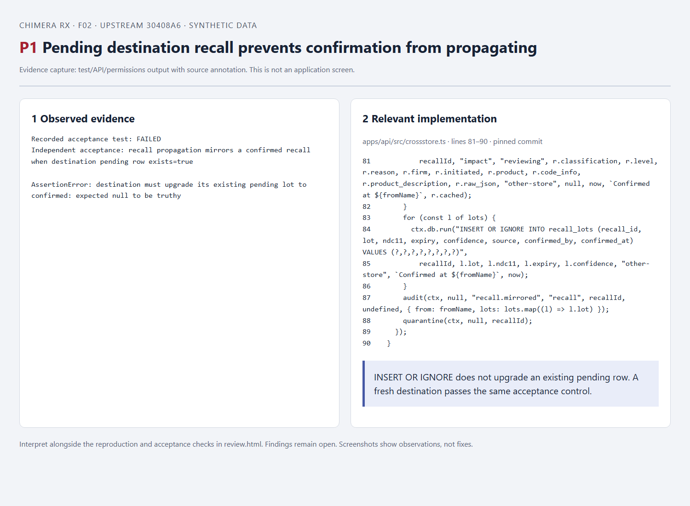

*Annotated evidence capture: INSERT OR IGNORE does not upgrade an existing pending row. A fresh destination passes the same acceptance control.*

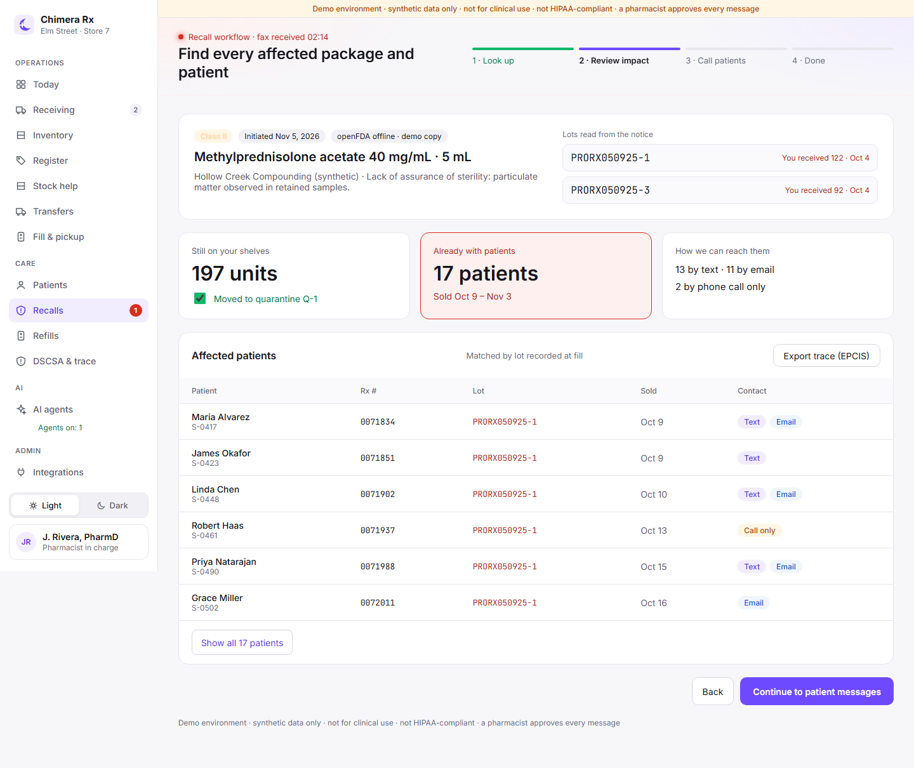

*Actual application screenshot: Recall workflow. Earlier synthetic browser rehearsal; workflow context only, not a capture of the backend failure.*

### F03 P1 — Clinical reads bypass cashier and admin role restrictions

**Evidence:** HTTP reproduction plus ten failed role acceptance checks.
**Source:** [apps/api/src/agents/routes.ts:107](https://github.com/pjborad/Chimera-Rx/blob/30408a6/apps/api/src/agents/routes.ts#L107). Also apps/api/src/agents/routes.ts:118; apps/api/src/app.ts:219,228,249.

**Reproduce:** After a pharmacist runs Guardian and confirms a recall, sign in as cashier m.diaz or admin s.grant. GET /api/agents/runs, /api/agents/rx-guardian, /api/recalls, /api/recalls/D-0611-2026 and /api/recalls/D-0611-2026/results. Each returns 200. Agent output contains patient IDs with clinical history; recall output exposes patient-linked impact or outreach information. /api/suggestions correctly returns 403.

**Impact:** Hiding clinical screens and protecting the patient endpoint does not protect alternate reads of the same data.

**Suggested implementation:** Define an explicit read authorization matrix. Gate clinical run history and recall patient details; return a separate minimal summary where a role needs counts. Filter by agent and role before serialization.

**Acceptance checks:** Anonymous reads return 401. Cashier/admin clinical detail reads return 403, or an explicitly specified sanitized summary without patient-linked clinical data. Pharmacist and permitted technician reads still work. Cover all downloads, audio, search, nested results and partner scopes.

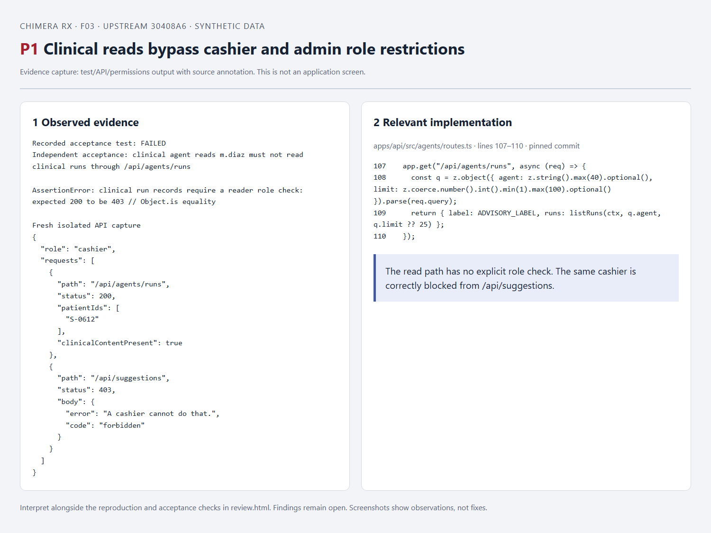

*Annotated evidence capture: The read path has no explicit role check. The same cashier is correctly blocked from /api/suggestions.*

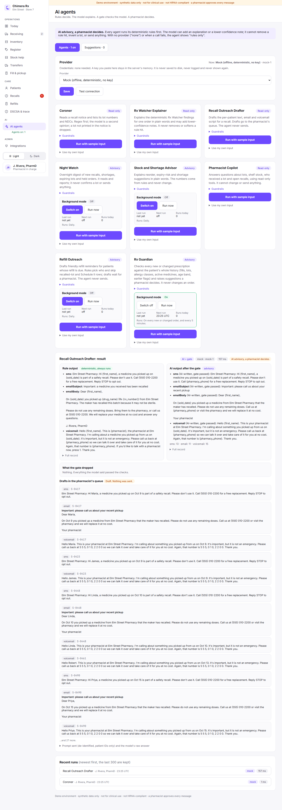

*Actual application screenshot: AI agents workflow. Earlier synthetic browser rehearsal; workflow context only, not a capture of the backend failure.*

### F04 P1 — Current locally sold medicines are omitted from some safety rules

**Evidence:** Pure-rule comparison with a passing Active control.
**Source:** [apps/api/src/agents/guardian.ts:115](https://github.com/pjborad/Chimera-Rx/blob/30408a6/apps/api/src/agents/guardian.ts#L115). Also apps/api/src/agents/guardian.ts:173,262; apps/api/src/rxwatcher.ts:63,195.

**Reproduce:** Evaluate a ciprofloxacin order with a two-day-old 68-day insulin fill. With history.status=Active the Guardian emits its fluoroquinolone/insulin demo-table interaction. Change only status to Sold here, the status loadHistory assigns to local dispenses: no hit is emitted.

**Impact:** A new local sale can be present in history but absent from interaction or duplicate-therapy evaluation. This finding demonstrates software inconsistency, not clinical accuracy of the synthetic rule.

**Suggested implementation:** Unify active-medication derivation across imported history, local dispenses, Watcher and Guardian using supply dates and discontinuation state. Avoid merely changing every historical sale to Active.

**Acceptance checks:** Receive/fill/verify/sell an unseeded current medicine, create the next relevant order and verify the expected demo rule. Include expired supply, discontinued medicine, duplicate imported/local history and corrected orders.

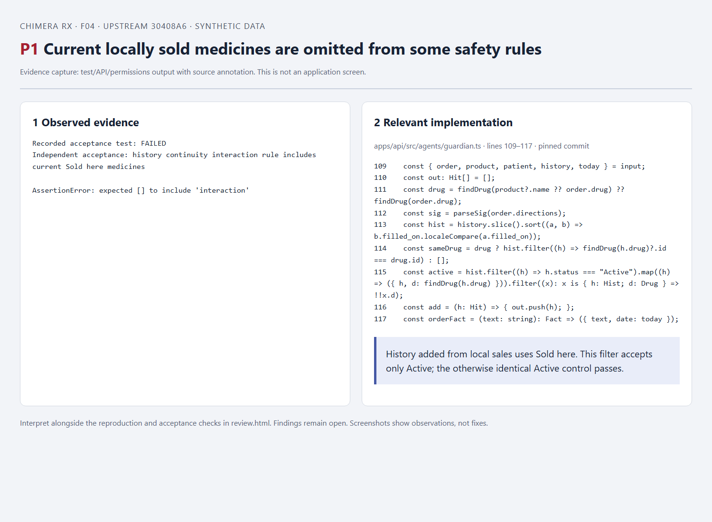

*Annotated evidence capture: History added from local sales uses Sold here. This filter accepts only Active; the otherwise identical Active control passes.*

### F05 P1 — Interrupted cross-store transfer duplicates available stock

**Evidence:** Injected source-write failure after destination commit.
**Source:** [apps/api/src/crossstore.ts:40](https://github.com/pjborad/Chimera-Rx/blob/30408a6/apps/api/src/crossstore.ts#L40). Also apps/api/src/crossstore.ts:54.

**Reproduce:** Select an on-shelf AMX0626C package. Inject a source database trigger that aborts its transfer-out update. Transfer one unit to Store 2. The operation throws, but the destination has already committed. The serial remains on_shelf in both stores.

**Impact:** The same physical serial is offered as available twice. A user retry does not provide an explicit reconciliation or durable transfer state.

**Suggested implementation:** Use a durable transfer ID and state machine with a source reservation, idempotent destination receipt, commit acknowledgement and recovery/reconciliation. A local transaction around one database does not make two files atomic.

**Acceptance checks:** Inject failure before and after each write boundary, restart and retry. At most one store can offer the serial. Incomplete transfers remain visible and recoverable, with consistent audit records.

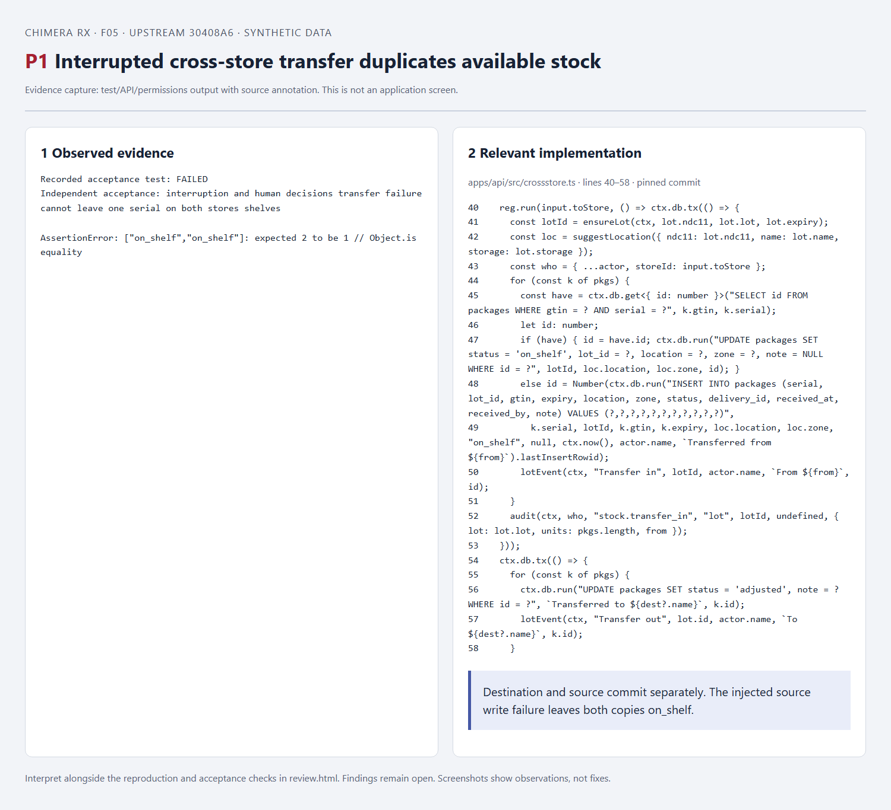

*Annotated evidence capture: Destination and source commit separately. The injected source write failure leaves both copies on_shelf.*

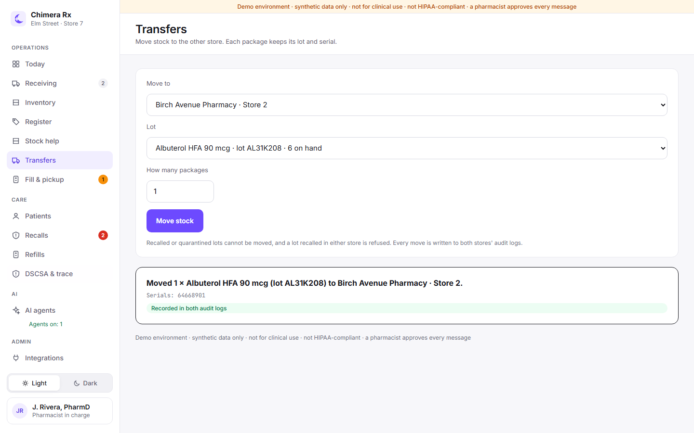

*Actual application screenshot: Transfer workflow. Earlier synthetic browser rehearsal; workflow context only, not a capture of the backend failure.*

### F06 P2 — Store 2 outputs retain Store 7 identity and contact details

**Evidence:** Source inspection; manufacturer-response improvement acknowledged.
**Source:** [apps/api/src/recall.ts:215](https://github.com/pjborad/Chimera-Rx/blob/30408a6/apps/api/src/recall.ts#L215). Also apps/api/src/recall.ts:217-225,238-242,364.

**Reproduce:** Use Store 2 to draft default recall outreach or generate its recall PDF. Templates hardcode Elm Street, J. Rivera and Store 7 phone; the PDF heading hardcodes Store 7. Store 2 has a different name, pharmacist and phone.

**Impact:** A correctly scoped patient list can still produce a misattributed report or direct a recipient to the wrong pharmacy.

**Suggested implementation:** Resolve pharmacy name, phone and signing actor from the current store at draft, preview, send and export time. Review voice templates and AI draft merging too.

**Acceptance checks:** Store 2 previews, sandbox sends and PDF use Birch Avenue, its own contact details and the approving actor. Store 7 remains correct. Do not count the fixed manufacturer-response path as coverage for all outputs.

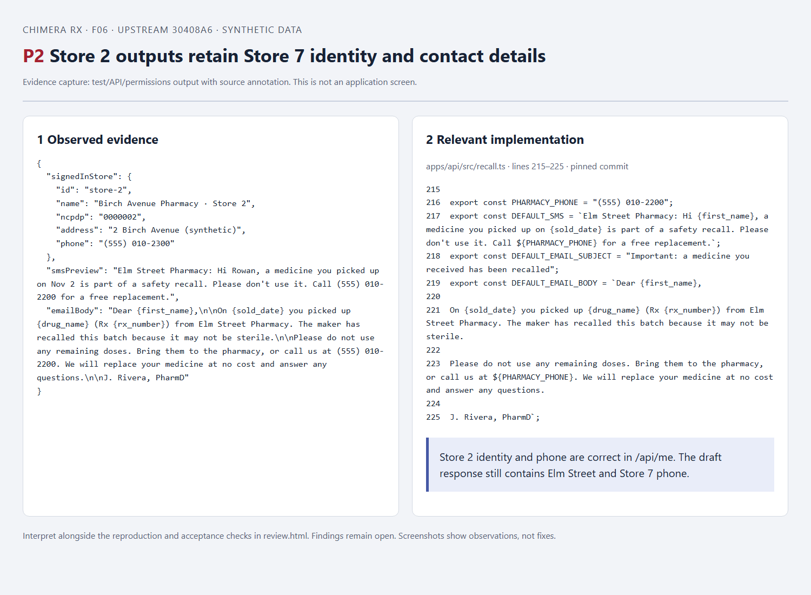

*Annotated evidence capture: Store 2 identity and phone are correct in /api/me. The draft response still contains Elm Street and Store 7 phone.*

### F07 P2 — Provider destination policy accepts mapped link-local addresses

**Evidence:** Provider-settings API accepted the URL; no metadata request made.
**Source:** [apps/api/src/agents/routes.ts:30](https://github.com/pjborad/Chimera-Rx/blob/30408a6/apps/api/src/agents/routes.ts#L30). Also apps/api/src/agents/providers.ts:102-109,320,353.

**Reproduce:** As an authorized pharmacist/admin, set baseUrl to http://[::ffff:169.254.169.254]/latest. The API returns 200 although literal 169.254 addresses are rejected. The settings were restored after this test.

**Impact:** The intended metadata-destination block is incomplete. Exploitation depends on configuration privileges, connectivity and the adapter POST path. Credential theft was not demonstrated.

**Suggested implementation:** Normalize and validate IP families and resolved destinations, including redirects. Make permitted local-model endpoints explicit. Bind stored credentials to approved origins when endpoints change.

**Acceptance checks:** IPv4, IPv6 mapped addresses, hostname resolution and redirect cases follow the same destination policy. Rejected destinations receive no request or credential. Intended localhost model endpoints remain usable.

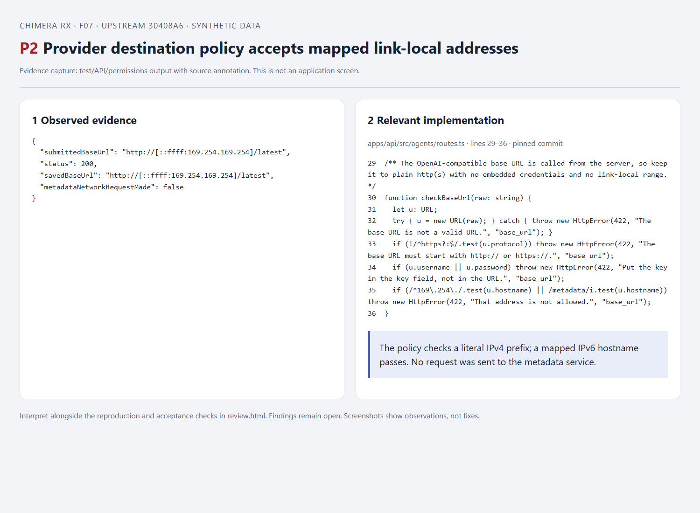

*Annotated evidence capture: The policy checks a literal IPv4 prefix; a mapped IPv6 hostname passes. No request was sent to the metadata service.*

### F08 P2 — Windows file-key permissions do not meet the owner-only claim

**Evidence:** Three Windows permission test failures and inspected generated-key ACL.
**Source:** [apps/api/src/crypto.ts:120](https://github.com/pjborad/Chimera-Rx/blob/30408a6/apps/api/src/crypto.ts#L120). Also apps/api/src/crypto.ts:124,131-135; docs/SECURITY.md.

**Reproduce:** Run the file-key provider on this Windows host. POSIX mode assertions report 0666 rather than 0600. The generated key also inherits a read grant to the local CodexSandboxUsers group in addition to the owner, SYSTEM and Administrators.

**Impact:** chmod does not establish the claimed owner-only boundary on this platform. This is not evidence of public access.

**Suggested implementation:** Define supported deployment platforms and enforce an appropriate Windows DACL, or require externally supplied keys on Windows. Document and test the actual access boundary.

**Acceptance checks:** An unauthorized local account cannot read the current, retired or temporary key files. Tests validate Windows ACLs on Windows and POSIX modes on Linux. Key rotation and restore still work.

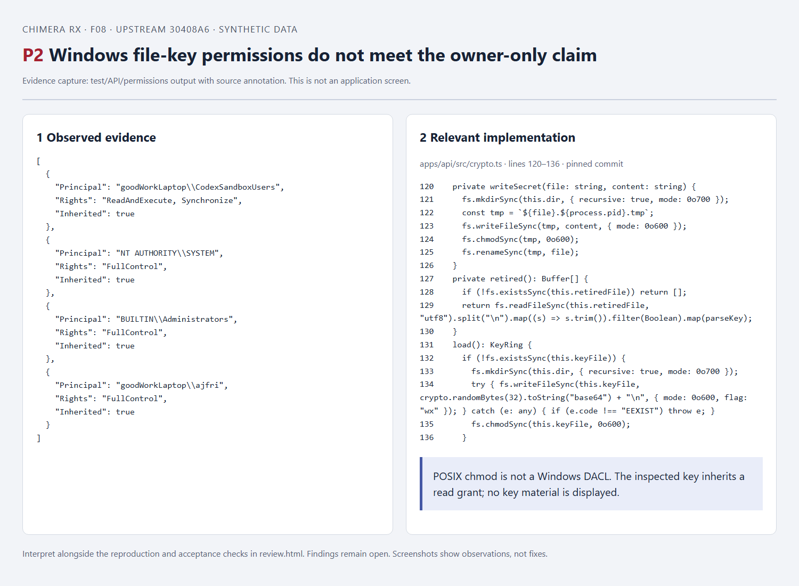

*Annotated evidence capture: POSIX chmod is not a Windows DACL. The inspected key inherits a read grant; no key material is displayed.*

## Run the acceptance suite

1. Check out commit `30408a6` and install its locked dependencies.
2. Copy `for-pritesh/independent-review-2026-11-22.test.ts` into `apps/api/test/`.
3. Run `pnpm exec vitest run apps/api/test/independent-review-2026-11-22.test.ts`.

Expected before fixes: **7 passed, 14 failed**. The suite uses isolated in-memory synthetic databases and does not reset a running demo.

## Remaining verification

- Clean Docker build and run with repository-specified pnpm; verify login, OCR assets, both stores and a full recall scenario.
- Physical webcam/printed-label and USB scanner review; curved-label OCR, damaged codes and conflicting lot/expiry/serial inputs.
- Keyboard and screen-reader review, contrast, zoom and smaller viewports; awaited browser assertions and MFA browser rehearsal.
- Live provider authentication, timeouts, disconnects and rate limits. Existing adversarial/mock tests passed; no paid/live provider calls were made.
- Real backup creation and restore, crash/restart reconciliation, key loss/rotation runbooks and disk-full behavior. Transfer interruption already has a reproduced defect.
- Review remaining GET/download/audio/search and partner-scope surfaces against the new read matrix; the checks here are targeted, not an exhaustive penetration test.
- Agree the pilot scope for KMS (currently a stub), clinical rule content, manufacturer verification, prescribing, messaging and payment. Those are sandbox or synthetic capabilities today; they are not completed production integrations.

## Evidence provenance

Eight annotated captures render actual recorded test/API/permissions observations alongside source pinned to the reviewed commit. Four actual app screenshots provide workflow context; they do not demonstrate the backend failures. Raw observations and test output are in `for-pritesh/`. The fresh API captures used isolated in-memory databases and offline/mock providers; no metadata-service request was made.

No live-model, physical scanner, clinical validity, compliance, full backup restoration or full Docker result is implied by this review.